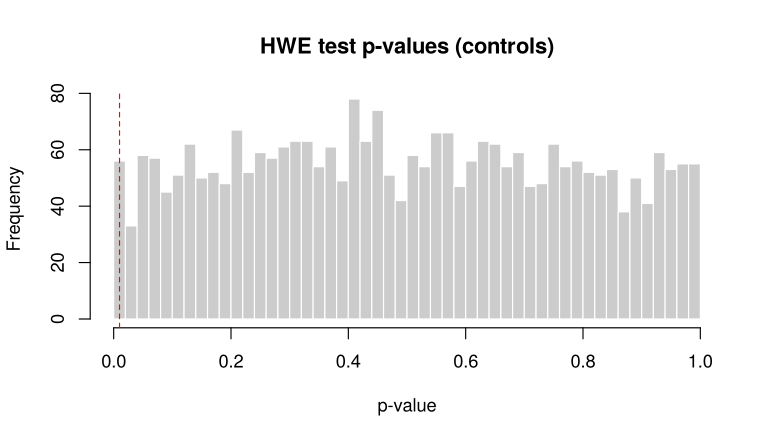
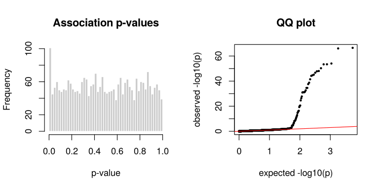

SNP analysis: example and observations
================

This notebook runs the three functions of `scripts/SNP_analysis.R` on
the course dataset and looks at what happens at each step: how many SNPs
the filters remove, what the HWE and association p-values look like, and
why multiple-testing correction matters here. The functions print to the
console; that output is hidden below.

## Data

``` r
SNPdata <- read.table(data_file, header = TRUE, sep = "\t", row.names = 1)
dim(SNPdata)
```

    ## [1] 2765 2000

``` r
table(group = ifelse(seq_len(ncol(SNPdata)) %in% indCTRL, "control", "case"))
```

    ## group
    ##    case control 
    ##    1200     800

``` r
table(genotype = unlist(SNPdata), useNA = "ifany")
```

    ## genotype
    ##       0       1       2 
    ## 3250116 1836785  443099

2765 SNPs, 800 controls and 1200 cases, with genotypes coded 0/1/2 and
no missing values.

## Quality filters

``` r
invisible(capture.output({
  MAF <- compute_MAF(SNPdata)
  HWE_p <- HWE_test(SNPdata[, indCTRL], tempfile(fileext = ".pdf"))
}))
fail_MAF <- MAF < 0.01
fail_HWE <- HWE_p < 0.01

c(SNPs = nrow(SNPdata),
  fail_MAF = sum(fail_MAF),
  fail_HWE = sum(fail_HWE),
  fail_both = sum(fail_MAF & fail_HWE),
  tested = sum(!fail_MAF & !fail_HWE))
```

    ##      SNPs  fail_MAF  fail_HWE fail_both    tested 
    ##      2765        14        34         1      2718

- The two filters remove 47 SNPs, and they barely overlap (only 1 SNP
  fails both).
- The MAF is computed as the frequency of allele `a` for every SNP, as
  the instructions require. For 1 SNP this frequency is above 0.5, so
  `a` is in fact the more common allele there; this does not affect the
  filter at 0.01.
- 135 SNPs have no `aa` genotype among controls. This is the situation
  the instructions warn about: expected counts stay positive as long as
  the allele is observed at all, so the HWE test is still defined, and
  only a monomorphic SNP would give a 0/0 term.

``` r
hist(HWE_p, breaks = 50, col = "grey80", border = "white",
     main = "HWE test p-values (controls)", xlab = "p-value")
abline(v = 0.01, col = "red", lty = 2)
```

<!-- -->

Under Hardy–Weinberg equilibrium the p-values would be roughly uniform.
The distribution is indeed broadly flat, and the 34 SNPs below 0.01 are
only slightly more than the ~28 expected by chance: at this threshold
the filter mostly removes SNPs that happen to fall in the tail, plus a
few genuine departures from equilibrium (possible genotyping errors).

## Association test

``` r
# SNP_association_test() writes test_boxplot.pdf to the working directory:
# run it from a temporary folder to keep the notebook folder clean
data_path <- normalizePath(data_file)
old_wd <- setwd(tempdir())
invisible(capture.output(
  res <- SNP_association_test(data_path, indCTRL = indCTRL, MAFth = 0.01, HWEalpha = 0.01)
))
setwd(old_wd)
G <- nrow(res)
c(tested = G,
  `p < 0.05` = sum(res[, "pval"] < 0.05),
  `expected by chance` = round(0.05 * G),
  `q < 0.05` = sum(res[, "qval"] < 0.05))
```

    ##             tested           p < 0.05 expected by chance           q < 0.05 
    ##               2718                171                136                 51

``` r
par(mfrow = c(1, 2))
hist(res[, "pval"], breaks = 50, col = "grey80", border = "white",
     main = "Association p-values", xlab = "p-value")
expected <- -log10(ppoints(G))
observed <- -log10(sort(res[, "pval"]))
plot(expected, observed, pch = 20, cex = 0.6,
     main = "QQ plot", xlab = "expected -log10(p)", ylab = "observed -log10(p)")
abline(0, 1, col = "red")
```

<!-- -->

- At p \< 0.05, 171 SNPs are selected, but about 136 would be selected
  even if no SNP were associated. Most of the “hits” at this threshold
  are expected false positives.
- The histogram is flat with a spike near 0, and the QQ plot follows the
  diagonal before departing sharply in the tail: most SNPs are null, and
  a minority carry a strong signal.
- Benjamini–Hochberg keeps 51 SNPs at q \< 0.05, and the count barely
  changes at q \< 0.1 (52), so the signal is well separated from the
  background.

The strongest associations, with genotype frequencies per group:

``` r
top <- res[order(res[, "pval"])[1:5], ]
freq <- cbind(top[, 1:3] / rowSums(top[, 1:3]), top[, 4:6] / rowSums(top[, 4:6]))
knitr::kable(data.frame(round(freq, 2),
                        pval = format(top[, "pval"], digits = 2),
                        qval = format(top[, "qval"], digits = 2)))
```

|                | AA_ctrl | Aa_ctrl | aa_ctrl | AA_case | Aa_case | aa_case | pval    | qval    |
|:---------------|--------:|--------:|--------:|--------:|--------:|--------:|:--------|:--------|
| chr6_159139270 |    0.94 |    0.06 |    0.00 |    0.58 |    0.37 |    0.05 | 3.1e-67 | 8.4e-64 |
| chr17_16842773 |    0.95 |    0.05 |    0.00 |    0.60 |    0.35 |    0.05 | 9.2e-67 | 1.2e-63 |
| chr7_147092861 |    0.82 |    0.17 |    0.01 |    0.48 |    0.42 |    0.11 | 9.3e-55 | 8.4e-52 |
| chr6_397261    |    0.94 |    0.06 |    0.00 |    0.63 |    0.33 |    0.04 | 3.9e-54 | 2.3e-51 |
| chrX_41029224  |    0.29 |    0.50 |    0.21 |    0.62 |    0.33 |    0.05 | 4.3e-54 | 2.3e-51 |

The top hits are extreme (p around 1e-54 to 1e-67) and have a large
effect: in four of them the `a` allele is rare in controls and far more
common in cases (risk allele), while in `chrX_41029224` the pattern is
reversed and `aa` is enriched in controls (protective allele).

## Cross-checks

The instructions forbid `chisq.test()` and `p.adjust()` inside the
functions, but they are useful to validate the manual implementation.

``` r
chisq_p <- apply(res[, 1:6], 1, function(x) {
  tab <- matrix(x, nrow = 2, byrow = TRUE)
  tab <- tab[, colSums(tab) > 0, drop = FALSE]   # chisq.test cannot handle empty columns
  suppressWarnings(chisq.test(tab, correct = FALSE)$p.value)
})
empty_class <- (res[, "AA_ctrl"] + res[, "AA_case"] == 0) |
               (res[, "Aa_ctrl"] + res[, "Aa_case"] == 0) |
               (res[, "aa_ctrl"] + res[, "aa_case"] == 0)

c(association_p_equal = isTRUE(all.equal(unname(res[, "pval"]), unname(chisq_p))),
  BH_q_equal = isTRUE(all.equal(unname(res[, "qval"]), unname(p.adjust(res[, "pval"], "BH")))),
  MAF_equal = isTRUE(all.equal(MAF, rowSums(SNPdata) / (2 * ncol(SNPdata)))))
```

    ## association_p_equal          BH_q_equal           MAF_equal 
    ##                TRUE                TRUE                TRUE

``` r
sum(empty_class)
```

    ## [1] 57

- All three agree with their reference implementations. The loop-based
  MAF also matches the one-line vectorised version
  `rowSums(SNPdata) / (2 * ncol(SNPdata))`.
- For 57 SNPs one genotype (always `aa`) is absent in both groups, so
  the table is effectively 2 × 2 with 1 degree of freedom instead of 2.
  The function sets the degrees of freedom from the genotypes actually
  observed, which is also what `chisq.test()` does once the empty column
  is dropped. Using 2 for every SNP would make these p-values
  conservative, although in this dataset the number of SNPs at q \< 0.05
  would not change.
