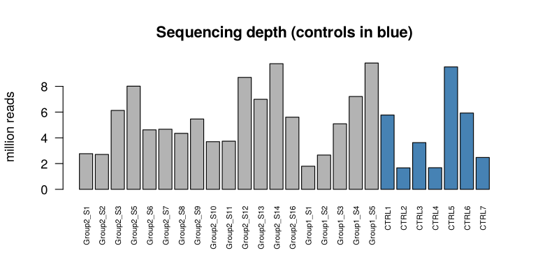
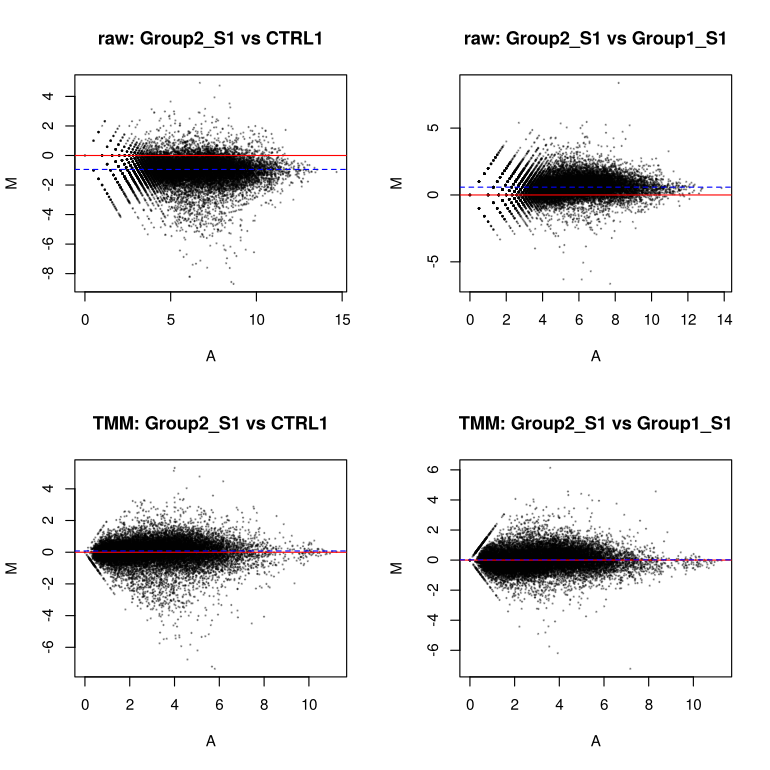
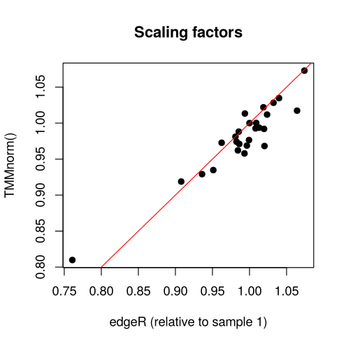
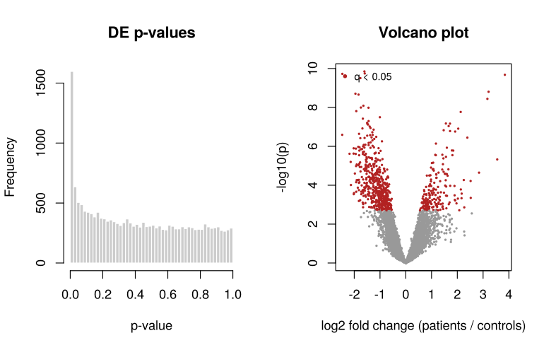
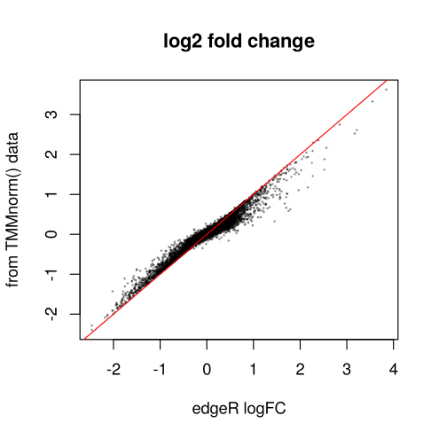

Bulk gene-expression analysis: example and observations
================

This notebook runs the functions of `scripts/gene_expression_analysis.R`
on the bone marrow count data and checks the two steps that are easiest
to get wrong: the TMM normalization, compared with edgeR’s own, and the
differential expression summary.

## Data

``` r
rawdata <- read.table("../data/raw_count.txt", header = TRUE, sep = "\t", row.names = 1)
annot <- read.table("../data/gene_annot.txt", header = TRUE, sep = "\t",
                    row.names = "Symbol", quote = "")
dim(rawdata)
```

    ## [1] 17936    26

``` r
table(sub("_.*|[0-9]+$", "", colnames(rawdata)))
```

    ## 
    ##   CTRL Group1 Group2 
    ##      7      5     14

``` r
sum(is.na(rawdata))                              # missing values
```

    ## [1] 0

``` r
identical(rownames(rawdata), rownames(annot))    # same genes, same order
```

    ## [1] TRUE

- 26 samples: 7 controls, 5 asymptomatic patients (Group1) and 14
  symptomatic patients (Group2). Groups are unbalanced, and the
  reference sample for MvA and TMM (the first column) is a Group2
  patient.
- No missing values, and the annotation lists exactly the same genes in
  the same order.

``` r
depth <- colSums(rawdata) / 1e6
barplot(depth, las = 2, cex.names = 0.6, col = ifelse(grepl("CTRL", names(depth)), "steelblue", "grey70"),
        ylab = "million reads", main = "Sequencing depth (controls in blue)")
```

<!-- -->

Sequencing depth varies about 5.9-fold across samples, so raw counts are
not comparable without normalization.

## MvA plots before and after TMM

``` r
TMM <- TMMnorm(rawdata, annot)
norm <- TMM$Normalized_exprData

mva <- function(x, ref, title) {
  M <- log2(ref + 1) - log2(x + 1)
  A <- (log2(ref + 1) + log2(x + 1)) / 2
  plot(A, M, pch = 20, cex = 0.3, col = rgb(0, 0, 0, 0.3), main = title)
  abline(h = 0, col = "red")
  abline(h = median(M[A > 2]), col = "blue", lty = 2)
}
show <- c("CTRL1", "Group1_S1")
par(mfrow = c(2, 2))
for (s in show) mva(rawdata[, s], rawdata[, 1], paste("raw:", colnames(rawdata)[1], "vs", s))
for (s in show) mva(norm[, s], norm[, 1], paste("TMM:", colnames(rawdata)[1], "vs", s))
```

<!-- -->

Before normalization the cloud of points is shifted away from M = 0
(blue dashed line: median M of expressed genes), because the two samples
were sequenced at different depths. After TMM the bulk of the genes is
centred on M = 0, which is the assumption behind TMM: most genes are not
differentially expressed. Gene-length scaling does not change M, since
the same gene is compared in both samples.

## Scaling factors compared with edgeR

`TMMnorm()` computes factors relative to sample 1 with a plain trimmed
mean of M values. edgeR’s `calcNormFactors()` uses the same idea with
weights and different trimming; with `refColumn = 1` the two can be
compared directly (edgeR divides library sizes by its factor, so the
comparable quantity is the ratio to sample 1’s factor).

``` r
library(edgeR)
nf <- calcNormFactors(DGEList(rawdata), refColumn = 1)$samples$norm.factors
edgeR_SF <- nf[1] / nf
plot(edgeR_SF, TMM$ScalingFactors, pch = 19, xlab = "edgeR (relative to sample 1)",
     ylab = "TMMnorm()", main = "Scaling factors")
abline(0, 1, col = "red")
```

<!-- -->

``` r
round(cor(edgeR_SF, TMM$ScalingFactors), 3)
```

    ## [1] 0.943

The two sets of factors agree closely (correlation 0.943). The small
differences come from edgeR’s precision weights and its default trimming
(30% of M, 5% of A) versus the 2% M trimming and fixed A window (0 to 8)
used here.

## Differential expression

``` r
groups <- colnames(rawdata)
DE <- DEbyEdgeR(rawdata, groups, alpha = 0.05)
DE$DEtestOutcomes
```

    ##      SelectedGenes     FalsePositives     FalseNegatives FalseDiscoveryRate 
    ##       2501.0000000        717.0000000       1803.0000000          0.2866853

``` r
res <- as.data.frame(DE$DEtestResults)
c(`p < 0.05` = sum(res$`p-value` < 0.05), `q < 0.05` = sum(res$`q-value` < 0.05))
```

    ## p < 0.05 q < 0.05 
    ##     2501      710

- At alpha = 0.05 without correction, 2501 genes are selected. Assuming
  80% of the 17936 genes are truly not differentially expressed (G0 =
  0.8 G, as required), about 717 of them are expected false positives,
  an estimated FDR of 0.29.
- Controlling the FDR at 5% with Benjamini–Hochberg keeps 710 genes.
- Patients are pooled as the instructions require; the asymptomatic and
  symptomatic groups are not compared with each other.

``` r
par(mfrow = c(1, 2))
hist(res$`p-value`, breaks = 50, col = "grey80", border = "white",
     main = "DE p-values", xlab = "p-value")
sig <- res$`q-value` < 0.05
plot(res$logFC, -log10(res$`p-value`), pch = 20, cex = 0.4,
     col = ifelse(sig, "firebrick", "grey60"),
     xlab = "log2 fold change (patients / controls)", ylab = "-log10(p)", main = "Volcano plot")
legend("topleft", legend = "q < 0.05", col = "firebrick", pch = 20, bty = "n", cex = 0.8)
```

<!-- -->

The p-value histogram has a clear peak near 0 over a flat background,
the shape expected when a sizeable fraction of genes is differentially
expressed. In the volcano plot the significant genes are spread on both
sides, but not evenly: 529 are down-regulated and only 181 up-regulated
in patients.

## Own fold change versus edgeR’s

The instructions allow either edgeR’s log fold change or one computed
from the normalized data as log2(mean in patients / mean in controls).
The two can be compared:

``` r
patients <- !grepl("CTRL", colnames(rawdata))
own_logFC <- log2(rowMeans(norm[, patients] + 1) / rowMeans(norm[, !patients] + 1))
plot(res$logFC, own_logFC, pch = 20, cex = 0.3, col = rgb(0, 0, 0, 0.3),
     xlab = "edgeR logFC", ylab = "from TMMnorm() data", main = "log2 fold change")
abline(0, 1, col = "red")
```

<!-- -->

``` r
round(cor(res$logFC, own_logFC), 3)
```

    ## [1] 0.979

The two estimates are strongly correlated (0.979), but the simple ratio
is systematically compressed towards 0. The normalized values are counts
per million per kilobase and are small for many genes (a quarter of the
genes have a mean below 2.4), so the +1 pseudocount is not negligible
and shrinks the ratio, most of all when one of the two groups has low
expression. edgeR’s estimate, fitted on raw counts with library-size
offsets, does not have this problem, which makes it the better choice
for `DEbyEdgeR()`.
