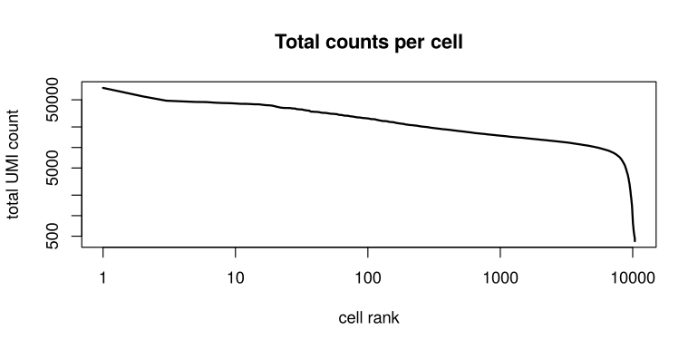
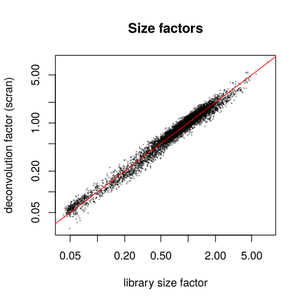
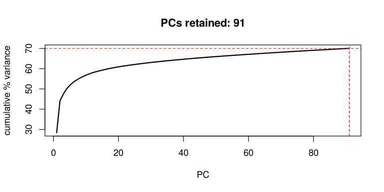
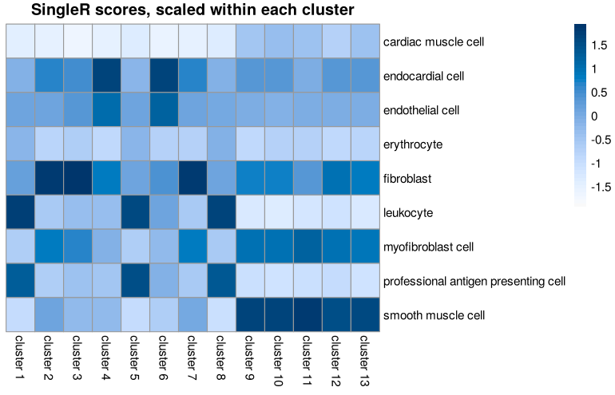
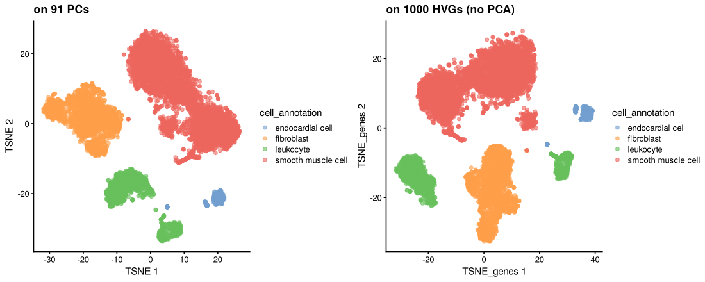
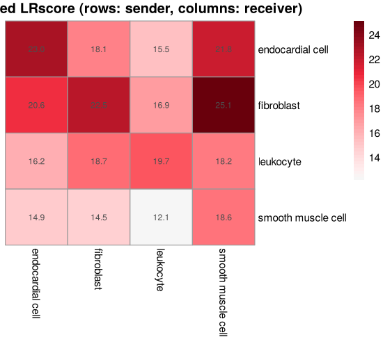

Single-cell RNA-seq analysis: example and observations
================

This notebook runs the three functions of `scripts/scRNA_analysis.R` on
the mouse artery data and looks at the choices behind each step:
filtering and normalization, the number of PCs, how the cell types are
assigned, what t-SNE shows, and what the ligand–receptor scores actually
rank.

## Data and filtering

``` r
load("../data/sce_count.RData")
load("../data/ref.RData")
load("../data/LRdb.RData")
dim(sce)
```

    ## [1] 15104 10378

``` r
c(all_zero_genes = sum(rowSums(counts(sce)) == 0),
  zero_fraction = round(mean(counts(sce) == 0), 3))
```

    ## all_zero_genes  zero_fraction 
    ##         97.000          0.815

``` r
totals <- sort(colSums(counts(sce)), decreasing = TRUE)
plot(seq_along(totals), totals, log = "xy", type = "l", lwd = 2,
     xlab = "cell rank", ylab = "total UMI count", main = "Total counts per cell")
```

<!-- -->

``` r
summary(totals)
```

    ##    Min. 1st Qu.  Median    Mean 3rd Qu.    Max. 
    ##     423    7476   10150    9990   12374   74738

- The matrix is very sparse (81% zeros), and 97 genes are never
  detected; these are the only genes `process_sce()` removes.
- Removing them does not change the plot above: genes with no counts add
  nothing to any cell’s total.
- The curve has only a short tail of low-count cells and no plateau of
  near-empty droplets, so the barcodes were already filtered to real
  cells before the data were shared.

## Normalization and PCA

``` r
set.seed(123)
sce <- process_sce(sce, n_HVG = 1000, percVar = 70)
```

    ## [1] "The number of Principal Components necessary to explain at least 70% of the total variance is: 91"

``` r
lib_sf <- scuttle::librarySizeFactors(sce)
plot(lib_sf, sizeFactors(sce), log = "xy", pch = 20, cex = 0.3, col = rgb(0, 0, 0, 0.3),
     xlab = "library size factor", ylab = "deconvolution factor (scran)", main = "Size factors")
abline(0, 1, col = "red")
```

<!-- -->

``` r
round(cor(log(lib_sf), log(sizeFactors(sce))), 3)
```

    ## [1] 0.987

The deconvolution factors from `scran` follow library size closely
(correlation of logs 0.987) but not exactly: they correct for
composition differences between cell types, which plain library size
cannot do.

``` r
n_PCs <- ncol(reducedDim(sce, "PCA"))
cum_var <- cumsum(attr(reducedDim(sce, "PCA"), "percentVar"))
plot(cum_var, type = "l", lwd = 2, xlab = "PC", ylab = "cumulative % variance",
     main = paste("PCs retained:", n_PCs))
abline(h = 70, v = n_PCs, col = "red", lty = 2)
```

<!-- -->

The first two PCs explain 44% of the variance, but reaching 70% takes 91
PCs, close to the cap of 100 computed in the first pass. Variance is
spread over many components, as usual for single-cell data where the
first PCs capture the main cell types and the rest is mostly noise. This
choice of `percVar` keeps much of that noise in the downstream
clustering and t-SNE; it is a requirement of the exercise, but a lower
threshold or an elbow criterion would normally retain far fewer PCs.

## Clustering and annotation

``` r
invisible(capture.output(sce <- annotation(sce, ref, tempfile(fileext = ".pdf"))))
table(cluster = sce$Louvain, cell_type = sce$cell_annotation)
```

    ##        cell_type
    ## cluster endocardial cell fibroblast leukocyte smooth muscle cell
    ##      1                 0          0      1245                  0
    ##      2                 0       1848         0                  0
    ##      3                 0        508         0                  0
    ##      4               273          0         0                  0
    ##      5                 0          0       475                  0
    ##      6               106          0         0                  0
    ##      7                 0        323         0                  0
    ##      8                 0          0        40                  0
    ##      9                 0          0         0               1907
    ##      10                0          0         0                836
    ##      11                0          0         0                193
    ##      12                0          0         0                354
    ##      13                0          0         0               2270

``` r
sort(table(ref$cell_ontology_class), decreasing = TRUE)
```

    ## 
    ##                           fibroblast                     endothelial cell 
    ##                                 2165                                 1250 
    ##                            leukocyte                   myofibroblast cell 
    ##                                  517                                  173 
    ##                     endocardial cell                  cardiac muscle cell 
    ##                                  164                                  119 
    ## professional antigen presenting cell                   smooth muscle cell 
    ##                                   55                                   42 
    ##                          erythrocyte 
    ##                                   25

- Louvain finds 13 clusters, which `SingleR` maps to only 4 of the 9
  reference cell types. Several clusters receive the same label, so the
  clustering is finer than the reference.
- Smooth muscle cells are the largest population in the artery data
  (5560 cells in 5 clusters), but the reference has only 42 of them.
  With cardiac muscle and endocardial cells among its types, the
  reference looks like heart tissue, so it fits this dataset only in
  part.
- Endothelial cells, the second largest population in the reference, are
  not assigned to any cluster. The clusters labelled “endocardial cell”
  also score high for endothelial cells (heatmap below): the two are
  closely related, and the label may well be endothelial for an artery.

The scores behind the cluster labels show how clear-cut each assignment
is:

``` r
logcounts(ref) <- counts(ref)
pred <- SingleR::SingleR(test = sce, ref = ref, labels = ref$cell_ontology_class,
                         clusters = sce$Louvain, de.method = "wilcox",
                         assay.type.ref = "counts", assay.type.test = "counts")
scores <- t(pred$scores)
colnames(scores) <- paste("cluster", rownames(pred))
pheatmap::pheatmap(scores, scale = "column", cluster_rows = FALSE, cluster_cols = FALSE,
                   color = hcl.colors(50, "Blues 3", rev = TRUE),
                   main = "SingleR scores, scaled within each cluster")
```

<!-- -->

### Counts or logcounts?

The instructions require `assay.type.ref = "counts"`. Running `SingleR`
on log-normalized data instead gives the same labels:

``` r
ref_log <- scuttle::logNormCounts(ref)
pred_log <- SingleR::SingleR(test = sce, ref = ref_log, labels = ref$cell_ontology_class,
                             clusters = sce$Louvain, de.method = "wilcox",
                             assay.type.ref = "logcounts", assay.type.test = "logcounts")
c(same_labels = identical(pred$labels, pred_log$labels))
```

    ## same_labels 
    ##        TRUE

This is not a consequence of sparsity: `SingleR` scores cells by
Spearman correlation on marker genes, which only uses ranks, and the log
transformation does not change the order of the values. Normalization
changes values across cells, which can affect marker selection, but here
it is not enough to change any label.

## t-SNE

``` r
set.seed(123)
sce <- scater::runTSNE(sce, subset_row = metadata(sce)$HVGs, assay.type = "logcounts",
                       perplexity = 100, name = "TSNE_genes")
gridExtra::grid.arrange(
  scater::plotReducedDim(sce, "TSNE", colour_by = "cell_annotation") +
    ggplot2::ggtitle(paste("on", n_PCs, "PCs")),
  scater::plotReducedDim(sce, "TSNE_genes", colour_by = "cell_annotation") +
    ggplot2::ggtitle("on 1000 HVGs (no PCA)"),
  ncol = 2)
```

<!-- -->

Computed on the PCs (as in `process_sce()`) or directly on the
log-expression of the HVGs, t-SNE separates the same four cell types;
the layout changes but the groups do not. With `dimred = "PCA"`,
`runTSNE()` ignores `subset_row`, so the PCs are the actual input. The
effect of perplexity (50, 100, 400) is shown in
`output/tSNE_perplexity_comparison.pdf`: higher values make the clusters
more compact and change their relative positions, but the cell types
stay separated in all three. Distances between clusters in a t-SNE plot
carry little meaning, so the layout should not be over-interpreted.

## Cell–cell communication

``` r
c(pairs = nrow(LRdb), ligands = length(unique(LRdb$ligand)),
  receptors = length(unique(LRdb$receptor)))
```

    ##     pairs   ligands receptors 
    ##       100        88        79

``` r
CCC <- CCCanalysis(sce, LRdb)
head(CCC, 8)
```

    ##    ligand receptor             sender           receiver  LRscore
    ## 1 Hsp90b1     Lrp1         fibroblast         fibroblast 9.912393
    ## 2 Hsp90b1     Lrp1          leukocyte         fibroblast 9.158891
    ## 3     Bsg     Cav1         fibroblast   endocardial cell 8.215840
    ## 4     Bsg     Cav1   endocardial cell   endocardial cell 8.078364
    ## 5 Hsp90b1     Lrp1   endocardial cell         fibroblast 7.068767
    ## 6 Hsp90b1     Lrp1 smooth muscle cell         fibroblast 7.044432
    ## 7     Bsg     Cav1 smooth muscle cell   endocardial cell 6.500095
    ## 8     Bsg     Cav1         fibroblast smooth muscle cell 5.441030

``` r
total <- tapply(CCC$LRscore, list(CCC$sender, CCC$receiver), sum)
pheatmap::pheatmap(total, cluster_rows = FALSE, cluster_cols = FALSE,
                   display_numbers = TRUE, number_format = "%.1f",
                   color = hcl.colors(50, "Reds 3", rev = TRUE),
                   main = "Summed LRscore (rows: sender, columns: receiver)")
```

<!-- -->

- Some ligands pair with several receptors, so the loop runs over pairs,
  not over ligands.
- The top of the ranking is occupied by two pairs, *Hsp90b1*–*Lrp1* and
  *Bsg*–*Cav1*, repeated across many sender–receiver combinations.
  *Hsp90b1* and *Bsg* are expressed in almost every cell, so `LRscore`,
  a product of mean expressions, ranks how abundant the genes are rather
  than how specific the interaction is.
- Summed over all pairs, the scores vary only about two-fold across
  sender–receiver combinations (12.1 to 25.1): no cell-type pair stands
  out clearly. Being means, the scores do not depend on how many cells
  each type has.
- Fibroblast-to-fibroblast comes first in the ranking. Autocrine pairs
  are scored like any other, as the instructions ask, so a population
  that expresses both ligand and receptor ranks highly with itself.
- Proper cell–cell communication tools (for example CellPhoneDB or
  CellChat) add a permutation test on cell labels and a specificity
  requirement, which this simple score lacks.
